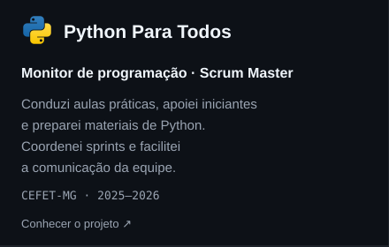
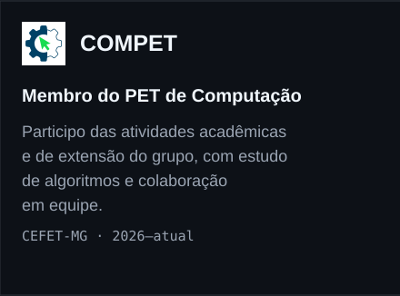

<picture>
  <source media="(prefers-color-scheme: light)" srcset="./img/apresentacao-light.svg">
  
</picture>

**Portfólio — [gabrieloliveiroa.vercel.app ↗](https://gabrieloliveiroa.vercel.app/)**

[LinkedIn](https://www.linkedin.com/in/gabrieloliveiroa/) · [gabrieloliveiraban@gmail.com](mailto:gabrieloliveiraban@gmail.com)

<picture>
  <source media="(prefers-color-scheme: light)" srcset="./img/projetos-light.svg">
  
</picture>

<a href="https://www.dm.cefetmg.br/extensao/python-para-todos-criatividade-e-programacao/"><picture><source media="(prefers-color-scheme: light)" srcset="./img/python-light.svg"></picture></a><a href="https://compet.vercel.app/"><picture><source media="(prefers-color-scheme: light)" srcset="./img/compet-light.svg"></picture></a>

<picture><source media="(prefers-color-scheme: light)" srcset="./img/tecnologias-centralizadas-light.svg"></picture>

##  Estatísticas do GitHub

