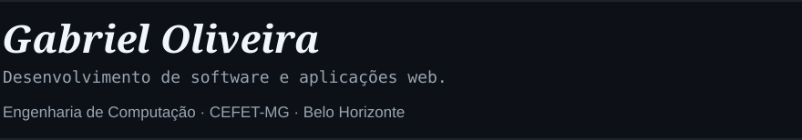
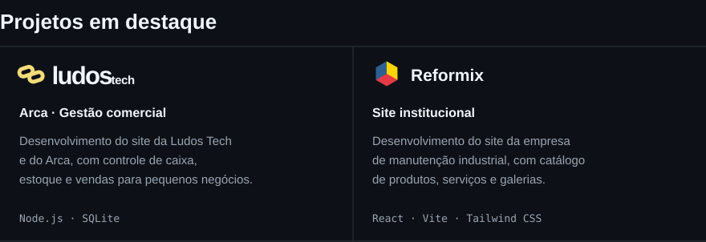

<picture>
  <source media="(prefers-color-scheme: light)" srcset="./img/apresentacao-light.svg">
  
</picture>

**Portfólio — [gabrieloliveiroa.vercel.app ↗](https://gabrieloliveiroa.vercel.app/)**

[LinkedIn](https://www.linkedin.com/in/gabrieloliveiroa/) · [gabrieloliveiraban@gmail.com](mailto:gabrieloliveiraban@gmail.com)

### Projetos em destaque

<picture>
  <source media="(prefers-color-scheme: light)" srcset="./img/projetos-light.svg">
  
</picture>

**Tecnologias** · JavaScript · React · Node.js · SQLite · Java · C

Estatísticas do GitHub

 
 

